<table>
<tr>
<td align="center" valign="middle"></td>
<td align="center" valign="middle"></td>
</tr>
</table>

### Sandeep Nidigonda — CSE Undergraduate · Web Development · AI & Open Source

## About

B.Tech Computer Science Engineering student (2024 – 2028) at **Vignan's Foundation for Science, Technology & Research**, Hyderabad. I build web projects, explore Data Science, Machine Learning and AI through Kaggle, and enjoy contributing to open source. Currently looking for a web development / software internship.

## Skills

## Experience

- **Campus Ambassador** — Brainovision Solutions India Pvt. Ltd. (Internship, remote) · Nov 2026 – Present
- **Media Coordinator** — Computer Society of India · Mar 2026 – Present

## Projects

- [College Hostel Webpage](https://github.com/Sandeepnidi2028/COLLAGE-HOSTEL-WEBPAGE-)
- [E-vaccine Reminder](https://github.com/Sandeepnidi2028/E-vaccine-remainder)
- [MEMORA — Smart India Hackathon project](https://github.com/Sandeepnidi2028/MEMORA-PROJ---SIH)
- [CSI-VFSTR Hyderabad Website](https://github.com/Sandeepnidi2028/CSI-VFSTR-Hyderabad-Website-ready-for-deployment)

## Certifications & Achievements

- Google AI Educator Series for India — Google for Education (Oct 2026)
- NPTEL Soft Skills, 12-week course — IIT Roorkee (Jul – Oct 2026)
- Adobe University Hackathon 2026, Round 1 online assessment — Unstop (Aug 2026)
- Tata GenAI Powered Data Analytics Job Simulation — Forage (Jul 2026)
- AI Tools Workshop — Be10x (May 2026)
- Shaastra 2026: E-Contest, Capture the Flag, Quantified Dilemma — Unstop (Jan 2026)

## Contribution graph

